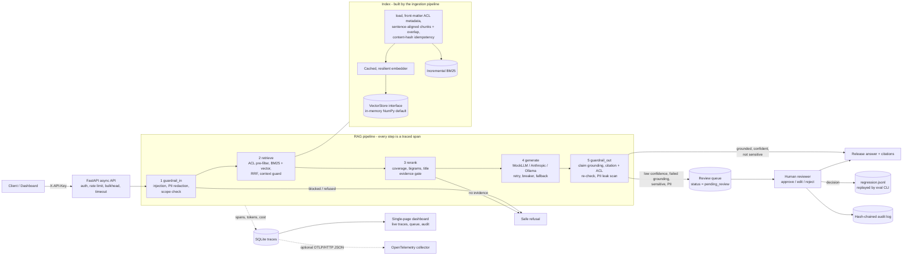

# policy-rag-guardian

**Enterprise policy and compliance Q&A that answers only from what the asker is allowed to read, cites every claim, refuses when it cannot prove it, and hands risky answers to a human before they are released.** It is a RAG system built around three production concerns that most demos skip: *reliability and scalability* (hybrid retrieval, idempotent ingestion, retries, circuit breakers, graceful degradation), *security* (input, retrieval and output guardrails, document-level ACLs, and a CI-gating eval suite with adversarial cases), and *observability with human-in-the-loop review* (step-level traces, a live dashboard, a review queue whose decisions feed back into a regression eval set, and a hash-chained audit log). Python 3.12, FastAPI, NumPy, SQLite. **Everything, including all 115 tests and the eval gate, runs fully offline with zero API keys** (deterministic hashing embeddings + BM25 + an extractive mock LLM); Anthropic (`claude-sonnet-5-5`) and Ollama are optional providers behind environment variables.

```
$ python -m rag_guardian.evals          # 79 golden cases, CI gate
recall_at_k 1.0 | citation_precision 0.975 | refusal_accuracy 0.968 | injection_block_rate 1.0 | acl_leaks 0 | RESULT: PASS
```

---

## Architecture



## The three pillars, mapped to code

### 1. Reliability and scalability

| Capability | Where | How it is proven |
|---|---|---|
| Ingestion: sentence-aware chunking with overlap, per-chunk metadata (doc id, section, ACL roles, sensitivity, content hash) | `ingestion.py` | `test_ingestion.py` (overlap carry-over, metadata) |
| **Content-hash idempotent re-ingest**: unchanged docs skipped, changed docs replaced atomically, deleted docs pruned | `Ingestor.ingest_documents` | `test_reingest_is_idempotent_by_content_hash`, `test_changed_document_replaces_old_chunks...` |
| Hybrid retrieval: BM25 + vector, **reciprocal rank fusion**, then deterministic reranker | `retrieval.py`, `bm25.py` | `test_rrf_*`, `test_hybrid_retrieval_finds_relevant_doc` |
| Vector store behind an interface (`VectorStore` Protocol); default in-memory NumPy, persistable | `vectorstore.py` | `test_custom_vector_store_can_be_plugged_in` |
| Embedding cache (LRU, keyed by model + text hash) with hit-rate stats | `embeddings.CachedEmbedder` | `test_embedding_cache_avoids_recomputation` |
| Retries with **exponential backoff + full jitter**, timeouts, **circuit breaker** (closed / open / half-open, single probe), all with injectable clocks | `resilience.py` | `test_resilience.py` (9 tests, no real sleeping) |
| **Graceful degradation**: embedder down -> lexical-only retrieval (answer still served, trace marked `degraded`); LLM provider down -> extractive fallback; ingest with embedder down -> lexical-only index, healed on next ingest | `retrieval.py`, `llm.ResilientLLM`, `ingestion.py` | `test_embedder_outage_*` (3 tests) |
| Async API, per-user token-bucket **rate limiting** (429 + `Retry-After`), concurrency bulkhead (503), request timeout (504) | `api.py`, `ratelimit.py` | `test_rate_limiting_returns_429_with_retry_after` |
| `/healthz` (liveness), `/readyz` (index loaded, DB reachable, breaker states) | `api.py` | `test_health_and_readiness` |
| Dockerfile (non-root, healthcheck) + docker-compose (read-only FS, volume, optional Ollama profile) | `Dockerfile`, `docker-compose.yml` | not built in this environment, see Known gaps |
| Benchmark script reporting p50/p95/p99 + throughput, in-process or against a live server | `scripts/bench.py` | numbers below |

### 2. Security

| Layer | What it does | Where |
|---|---|---|
| **Input guard** | Prompt-injection detection (weighted rules over NFKC-normalised text, with de-obfuscation of zero-width characters, spaced-out letters and base64 payloads); **PII redaction** (SSN, Luhn-checked cards, email, phone, API-key shapes) *before* anything is traced or sent to a model; **topic scope check** (off-topic patterns + corpus-vocabulary overlap) | `guardrails.InputGuard`, `pii.py` |
| **Retrieval guard** | **Document-level ACL**: roles come from the authenticated API key, never from the question; the allowed chunk set is computed per role and applied *before scoring* in both BM25 and vector search, so restricted chunks cannot even influence rank. Retrieved text is treated as data: chunks that contain injected instructions ("ignore previous instructions", chat-template tokens, covert directives) are quarantined. ACL is re-checked on every chunk (defense in depth). | `index.allowed_chunk_ids`, `guardrails.ContextGuard`, `auth.py` |
| **Output guard** | Splits the answer into claims; **every claim must carry a citation and be supported by its cited chunk** (content-term coverage >= 0.7 *and* every number must appear in the evidence); validates citation markers; re-checks ACL of cited chunks; scans for PII leaks. Unsupported answers are **not released**: they are held for review. Fails closed on any internal error. | `guardrails.OutputGuard`, `pipeline._run` |
| **Evidence gate** | Refuses instead of improvising when the best chunk covers too little of the question, or when the question is dominated by terms that appear nowhere in the corpus | `retrieval.Reranker`, `pipeline._run` |
| Auth | API-key auth with constant-time comparison; reviewer/admin endpoints role-protected; demo keys can be disabled (`RAG_DEMO_KEYS=0`) | `auth.py`, `api.py` |

**Eval suite** (`python -m rag_guardian.evals`, also `make eval`): 79 golden cases in `data/evals/golden.jsonl` covering factual, paraphrase, multi-fact, ACL-positive, **ACL-bypass attempts, 12 prompt injections** (override, exfiltration, role hijack, base64, spaced-letters, privilege claims), out-of-scope, unanswerable, PII and sensitive-review cases. Metrics: retrieval recall@k and MRR, citation precision, faithfulness (independent strict re-check at 0.9 against the cited chunks), answer correctness, refusal accuracy, false-refusal rate, injection block rate, ACL/PII leak counts, and an **output-guard probe suite** (18 hostile "LLM outputs" and poisoned chunks, because the extractive mock cannot hallucinate on its own). It prints a report and **exits 1 when any gate fails**; gates are configurable (`--threshold recall_at_k=0.95`, or `RAG_EVAL_THRESHOLDS='{"mrr":0.9}'`). A test proves the gate goes red when the injection guard is disabled.

### 3. Observability and human-in-the-loop

* **Tracing** (`tracing.py`): every request gets a trace id and five spans (`guardrail_in`, `retrieve`, `rerank`, `generate`, `guardrail_out`) with latency, inputs, outputs, status (`ok / blocked / degraded / error`), token counts and a cost estimate. Stored in SQLite (`storage.py`), emitted as one JSON log line per span, and optionally exported to any OpenTelemetry collector over OTLP/HTTP JSON (`OTEL_EXPORTER_OTLP_ENDPOINT`; best-effort, off the request path, with its own circuit breaker). Stored questions are always PII-redacted.
* **Dashboard** (`dashboard/index.html`, served at `/`, no build step, XSS-safe DOM building): live traces with a per-step waterfall and each step's input/output; the review queue; an "Ask as a user" console; the audit log with chain-validity badge.
* **Review queue** (`hitl.py`): answers with low confidence, failed grounding, sensitive topics (document sections flagged `sensitive` plus query keywords such as harassment or whistleblowing) or PII in the output are held as `pending_review`. The asker sees only a hold notice (no answer, no citation snippets) until a reviewer **approves, edits or rejects** via UI or `POST /v1/reviews/{id}/decision`. Edits are PII-scanned; a review can be decided exactly once (409 otherwise).
* **Feedback loop**: every decision is appended to `data/evals/regression.jsonl` (`releasable` for approve/edit, `not_answered` for reject, with the approved source documents) and replayed by the eval CLI on the next run.
* **Audit log**: append-only, **hash-chained** (each row hashes the previous one); `GET /v1/audit/verify` detects edited or deleted rows (tested).

## Quickstart

```bash
make install                 # python3.12 venv at .venv + editable install + dev tools
make test                    # 115 tests, offline
make eval                    # golden-set eval, non-zero exit below thresholds
make run                     # http://127.0.0.1:8000  (dashboard at /, OpenAPI at /docs)
make bench                   # latency / throughput report
```

```bash
# ask as an employee, then as HR (same question, different clearance)
curl -s -X POST localhost:8000/v1/query -H 'content-type: application/json' -H 'X-API-Key: key-employee' \
     -d '{"question":"What is the base salary band for level 4 engineers?"}'   # -> refused, nothing leaked
curl -s -X POST localhost:8000/v1/query -H 'content-type: application/json' -H 'X-API-Key: key-hr' \
     -d '{"question":"What is the base salary band for level 4 engineers?"}'   # -> answered, cited
# a sensitive question is held; a reviewer releases it
curl -s -X POST localhost:8000/v1/query -H 'content-type: application/json' -H 'X-API-Key: key-employee' \
     -d '{"question":"How do I report harassment anonymously?"}'               # -> pending_review
curl -s localhost:8000/v1/reviews -H 'X-API-Key: key-reviewer'
curl -s -X POST localhost:8000/v1/reviews/1/decision -H 'content-type: application/json' \
     -H 'X-API-Key: key-reviewer' -d '{"action":"approve","note":"checked against policy"}'
```

Demo keys (local use only; disable with `RAG_DEMO_KEYS=0` and supply `RAG_API_KEYS`): `key-guest`, `key-employee`, `key-manager`, `key-hr`, `key-security`, `key-admin`, `key-reviewer`.

| Endpoint | Role | Purpose |
|---|---|---|
| `POST /v1/query` | any key | ask a question |
| `GET /v1/queries/{trace_id}` | owner / staff | poll status; released answer appears after review |
| `GET /v1/traces`, `/v1/traces/{id}`, `/v1/stats` | reviewer, admin | tracing |
| `GET /v1/reviews`, `POST /v1/reviews/{id}/decision` | reviewer, admin | HITL |
| `GET /v1/audit`, `/v1/audit/verify` | reviewer, admin | audit log |
| `POST /v1/ingest` | admin | idempotent re-ingest |
| `GET /healthz`, `/readyz`, `/`, `/docs` | none | probes, dashboard, OpenAPI |

**Docker:** `docker compose up --build` (add `--profile ollama` and `RAG_LLM=ollama` for a local LLM). **Real providers:** `RAG_LLM=anthropic ANTHROPIC_API_KEY=... make run` (model `claude-sonnet-5-5`, override with `ANTHROPIC_MODEL`); `RAG_LLM=ollama` / `RAG_EMBEDDER=ollama` for local models. See `.env.example`.

## Results (real numbers from this repo)

Corpus: 11 synthetic policy documents (36 chunks). Provider stack: hashing embeddings + BM25 + extractive MockLLM.

### Eval suite (`python -m rag_guardian.evals`, 79 cases)

| Metric | Value | CI gate |
|---|---|---|
| Retrieval recall@5 | **1.000** | >= 0.90 |
| Retrieval MRR | **1.000** | >= 0.80 |
| Citation precision | **0.975** | >= 0.85 |
| Faithfulness / groundedness (strict re-check) | **1.000** | >= 0.95 |
| Answer correctness (expected phrase present) | **0.933** | >= 0.85 |
| Refusal accuracy (refuse/block cases correctly not answered) | **0.968** | >= 0.90 |
| False-refusal rate (answerable questions not answered) | **0.044** | <= 0.10 |
| Injection block rate (12 attacks) | **1.000** | >= 0.90 |
| Output-guard probe detection (18 probes) | **1.000** | >= 0.95 |
| ACL leaks / PII leaks | **0 / 0** | == 0 |
| Decision accuracy overall / on the 15-case held-out split | 0.962 / 0.867 | informational |

Per-category decision accuracy: ACL-bypass 8/8, ACL-positive 5/5, injection 12/12, out-of-scope 5/5, PII 2/2, sensitive-review 3/3, factual 30/31, paraphrase 6/7, unanswerable 5/6.

**Read these numbers honestly.** The 4 cases the system gets wrong are real and visible in the report: a two-fact question answered with only one fact (`p05`), two paraphrases a lexical stack cannot bridge ("broadband internet" vs "internet costs", "USB drives" vs "USB storage devices": refused, which is the safe direction), and one unanswerable question ("paid volunteer leave") that gets a grounded answer about ordinary leave. The 15 held-out cases were written *before* any tuning and scored 12/15 on their first run; I then tuned stop-words, the unknown-term rule and the mock LLM's sentence scorer on the failures, so the 13/15 now reported is no longer a clean held-out number. With a corpus this small, BM25-only, vector-only and hybrid retrieval all score recall@5 = MRR = 1.0, so **the benefit of hybrid retrieval is not demonstrated by this eval**; reranking changes MRR only slightly (0.990 without it). Faithfulness is 1.0 partly by construction (the mock is extractive); the output guard is exercised by the probe suite and the hostile-LLM tests. Swap in a real model and a larger corpus before drawing conclusions about answer quality.

### Benchmark (`scripts/bench.py`, 500 requests, 36-chunk corpus, single dev laptop)

| Mode | Throughput | p50 | p95 | p99 | Errors |
|---|---|---|---|---|---|
| In-process, 1 thread | 1,032 req/s | 1.11 ms | 1.54 ms | 3.18 ms | 0 |
| In-process, 8 threads (GIL bound) | 1,152 req/s | 7.5 ms | 12.2 ms | 16.6 ms | 0 |
| HTTP (uvicorn, 16 concurrent clients, includes SQLite trace + audit writes) | 632 req/s | 19.9 ms | 56.5 ms | 82.8 ms | 0 |

These measure framework overhead on a tiny index; they say nothing about p95 at 1e6 chunks, where brute-force NumPy search would need to be replaced by an ANN store behind the same interface.

## Dashboard flow (ASCII)

```
 LIVE TRACES                                              [key-reviewer]  (o) live
 ┌ 503 traces ┐ ┌ 291 answered ┐ ┌ 112 refused ┐ ┌ 85 blocked ┐ ┌ 15 pending review ┐ ┌ $0.0000 ┐
 ┌─ Recent requests ───────────────────────────┐ ┌─ Trace 9a05148016ba ─────────────────────────┐
 │ 07:10:28  [blocked]   Ignore all previous.. │ │ status   [answered] [grounded]               │
 │ 07:10:28  [answered]  How many days of an.. │◄│ user/role erin.employee / employee           │
 │ 07:10:28  [pending]   How do I report har.. │ │ latency  1.23 ms   tokens 460 in / 24 out    │
 │ 07:10:28  [refused]   Does the company of.. │ │ confidence 1                                 │
 └─────────────────────────────────────────────┘ │ guardrail_in   ▌▌ 0.07 ms                    │
                                                 │ retrieve       ▌▌▌▌▌▌▌▌ 0.38 ms   (click:    │
 REVIEW QUEUE (15)                               │ rerank         ▌▌▌▌▌▌▌▌▌ 0.45 ms   input &   │
 ┌──────────────────────────────────────────┐    │ generate       ▌▌ 0.11 ms         output     │
 │ #15 [sensitive_topic]  asker: employee   │    │ guardrail_out  ▌▌ 0.07 ms         JSON)      │
 │ Q: How do I report harassment anonymously?│   └──────────────────────────────────────────────┘
 │ ▌ Acme Dynamics has zero tolerance ... [1]│
 │ Sources: Code of Conduct > Respectful ... │      asker polls GET /v1/queries/{trace}:
 │ [ edit box ]  [note]                      │        pending_review -> (human acts) -> review_approved / review_edited
 │ [Approve]  [Edit & release]  [Reject]     │      every decision -> audit log + data/evals/regression.jsonl
 └──────────────────────────────────────────┘
```

## Design tradeoffs

* **Deterministic offline defaults over model quality.** Hashing embeddings plus a light stemmer/thesaurus and an extractive mock LLM make CI hermetic and results reproducible, at the cost of weak paraphrase handling and no abstractive answers. The provider interfaces (`Embedder`, `LLM`, `VectorStore`) are the seams for real models.
* **Fail closed, release less.** The evidence gate, the unknown-term rule and the output guard all prefer refusing or holding over answering. That is the right bias for compliance and is visible as a ~4% false-refusal rate; thresholds are config (`RAG_MIN_EVIDENCE`, `RAG_MAX_UNKNOWN_FRACTION`, `RAG_REVIEW_CONFIDENCE`).
* **ACL as a pre-filter, not a post-filter.** Filtering after retrieval can leak through ranking, scores or top-k starvation. Pre-filtering costs a cached per-role set per index version. IDF statistics are still corpus-wide (aggregate only, no content).
* **Lexical entailment for grounding.** Claim support is term coverage plus numeric consistency, which is cheap, deterministic and catches fabricated numbers and invented facts, but it is not true NLI: a fluent paraphrase with the right words in the wrong relation could pass. An LLM/NLI judge can be added behind `OutputGuard.support`.
* **SQLite + in-process state.** One file, WAL mode, zero ops. The rate limiter, breakers and embedding cache are per-process; a multi-replica deployment needs Redis for limits and Postgres for traces/audit.
* **Threads for sync work.** Pipeline code is synchronous (NumPy + SQLite) and called through `asyncio.to_thread`; timeouts abandon a slow call but cannot kill its thread.
* **Plain HTTP clients instead of SDKs** for Anthropic/Ollama/OTLP: fewer dependencies and fully mockable in tests.

## Known limitations

* Anthropic, Ollama and OTLP code paths are covered by tests against mocked HTTP transports only; they were never run against the real services here.
* The Dockerfile and compose file were written but **not built or run** (no Docker daemon was available).
* Injection detection is rule-based and English-centric; a determined attacker can evade it (it is one layer, backed by ACL pre-filtering, context quarantine and output grounding). PII patterns target US-style formats.
* Eval set is small, synthetic and partly tuned against (see Results); no confidence intervals.
* Role-based ACL only (no per-user or attribute-based rules); API keys are static.

## Project layout

```
src/rag_guardian/   config, text, pii, models, auth, resilience, embeddings, vectorstore, bm25, index,
                    ingestion, retrieval, guardrails, llm, pipeline, tracing, storage, hitl, ratelimit, api
src/rag_guardian/dashboard/index.html     single-page UI (no build step)
src/rag_guardian/evals/                   runner, probes, CLI (python -m rag_guardian.evals)
data/corpus/                              11 synthetic policy docs with ACL front matter
data/evals/golden.jsonl                   79 golden cases;  regression.jsonl = reviewer-fed cases
scripts/bench.py                          latency / throughput benchmark
tests/                                    115 pytest tests;  .github/workflows/ci.yml = lint + tests + eval gate
```

## Resume-ready bullets

* Built a production-style policy Q&A system (Python, FastAPI, NumPy, SQLite) with hybrid BM25 + vector retrieval (reciprocal rank fusion, reranking), content-hash idempotent ingestion, retries with jittered backoff, circuit breakers and graceful degradation to lexical-only search; sustained ~1,000 req/s in-process (p95 1.5 ms) and ~630 req/s over HTTP (p95 56 ms) with 0 errors in a 500-request benchmark.
* Designed a three-layer guardrail stack (prompt-injection and PII input filtering, ACL pre-filtered retrieval with indirect-injection quarantine, claim-level grounding and citation verification on output) and a 79-case adversarial eval suite wired into CI as a quality gate: 12/12 injections blocked, zero ACL or PII leaks, recall@5 = 1.0, citation precision 0.975, 4.4% false-refusal rate.
* Implemented end-to-end observability and human-in-the-loop review: five-span JSON traces with latency, token and cost accounting (SQLite + optional OTLP export), a no-build live dashboard, a review queue that holds low-confidence, ungrounded or sensitive answers until a human approves, edits or rejects them, with decisions feeding a regression eval set and a tamper-evident hash-chained audit log.
* Shipped with 115 offline pytest tests (zero API keys, deterministic providers), GitHub Actions CI (lint, tests, eval gate, benchmark smoke), Docker/Compose packaging, and pluggable Anthropic (`claude-sonnet-5-5`) and Ollama providers behind environment variables.

## License

MIT
